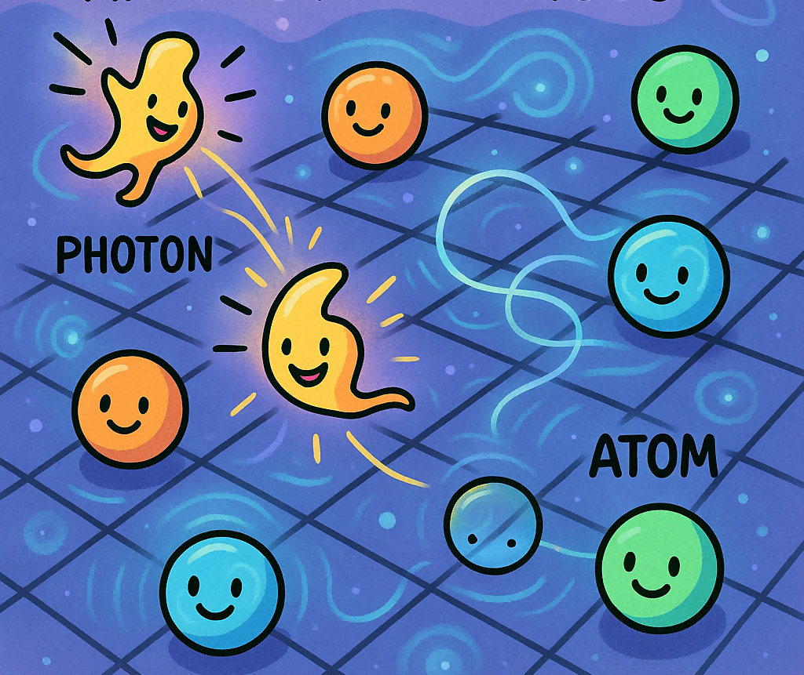
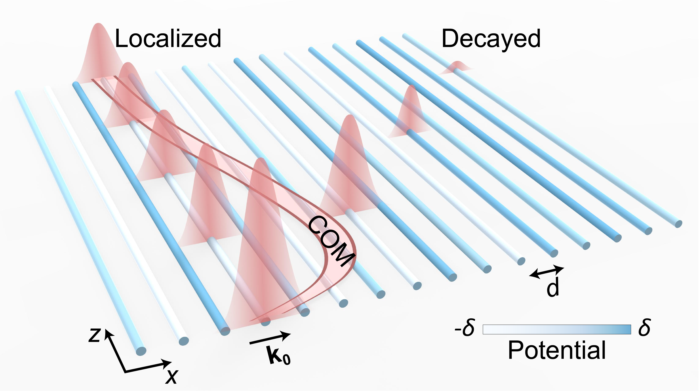
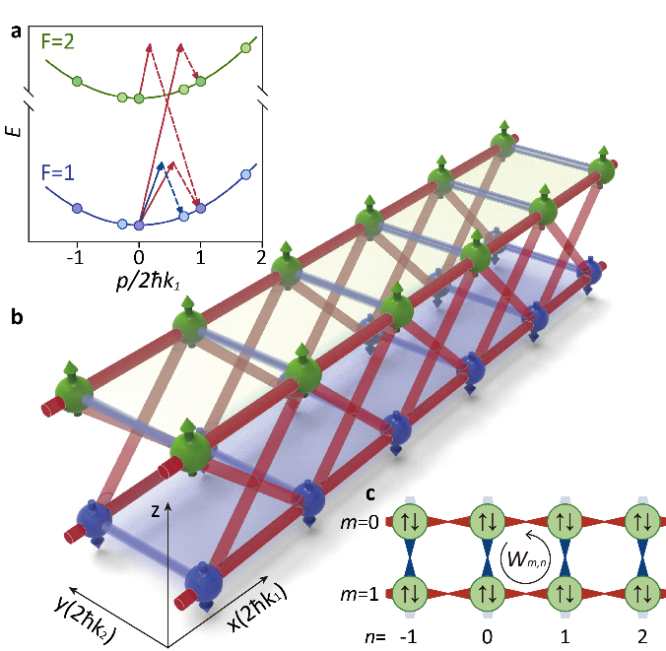
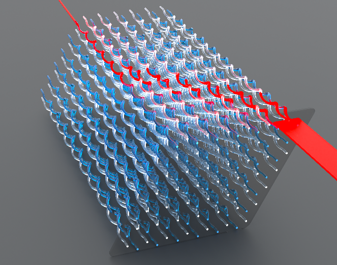
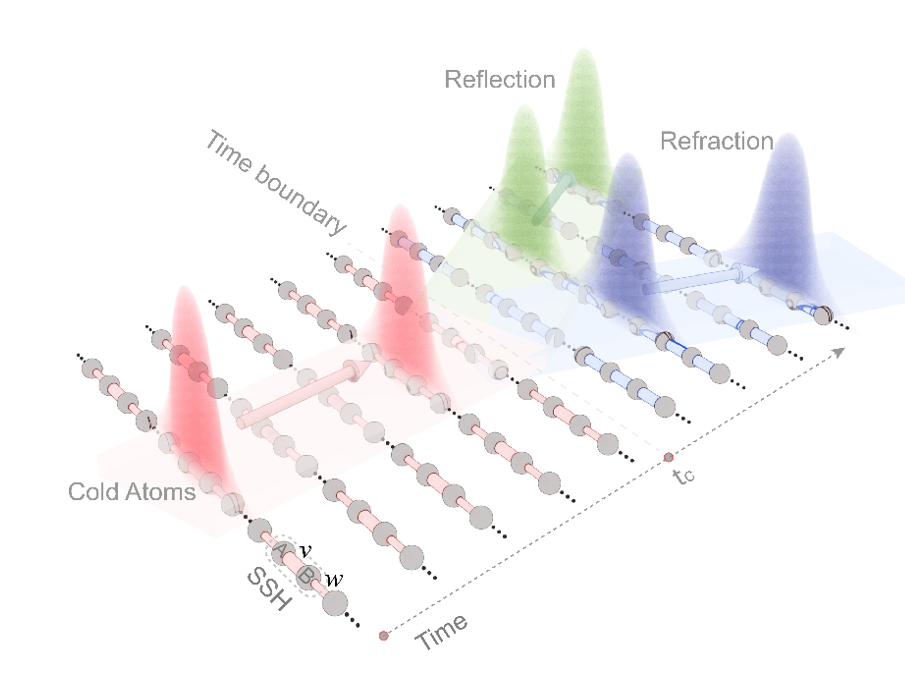
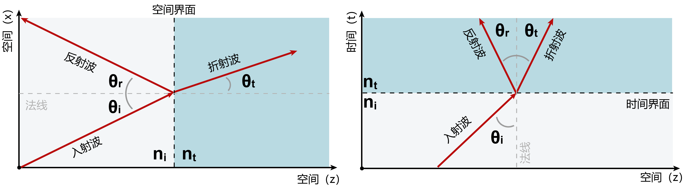

Zhaoju Yang  
Tenure-track professor of [School of Physics](https://physics.zju.edu.cn/), [Zhejiang University](https://www.zju.edu.cn/) at Hangzhou, China.

**Experience**  
2020.09- : Zhejiang University, School of Physics.  
2018-2020: Technion – Israel Institute of Technology, Physics, Postdoc Fellow.  
2013-2017: Nanyang Technological University - NTU Singapore, Physics, PhD.  
2009-2013: Jilin University, Physics, BSc.  

**Teaching**  
Mechanics, Undergraduate, Fall and Winter terms.

Research
======

 

We are dedicated to exploring the profound mysteries of the quantum world through the artificial lattices of photons and atoms. We aim to transcend the boundaries of conventional matter and uncover exotic topological, non-Hermitian, and many-body quantum phases:  
Theoretical Innovation: Starting from fundamental principles, we predict novel quantum phase transitions and topological protection mechanisms.  
Experimental Mastery: Utilizing advanced platforms such as photonic crystals, we transform abstract physical models into observable reality.  
Our group, as leading authors, has published papers in Science, Nature Photonics, Nature Physics, PRL/PRX, and Nature Commun., et. al. We are looking for brilliant, curious, and driven students and postdocs who are eager to prove themselves amidst the challenges of theoretical thinking and experimental rigor.

News
======
2026 [Nature Commun.](https://www.nature.com/articles/s41467-026-68293-8): Quantum boomerang effect of light.

  
  <!--  -->

 

2026 [Advanced Materials](https://doi.org/10.1002/adma.202519324): We have proposed and realized the Non-Hermitian Hybrid Topological Insulators.

<!--  -->
2024 [Nature Physics](https://www.nature.com/articles/s41567-024-02644-4): Chiral dynamics of ultracold atoms under a tunable SU(2) synthetic gauge field. ZJU [news1](https://mp.weixin.qq.com/s/UmNhIYGsmS2ypfKns5Vu-w), [news2](https://mp.weixin.qq.com/s/UmNhIYGsmS2ypfKns5Vu-w).

  
  

 
<!--  -->

2024 [Phys. Rev. Lett.](https://journals.aps.org/prl/pdf/10.1103/PhysRevLett.132.063804): Floquet 1D non-Hermitian skin effect and Floquet skin-topological effect in optical arrays of helical waveguides. Phys. Rev. Lett. 132, 063804 (2024). [News](http://physics.zju.edu.cn/2024/0216/c69694a2877676/page.htm).

2023 [Nature Photonics](https://doi.org/10.1038/s41566-023-01290-1): Quantum time refraction/reflection for matter waves. Nature Photonics 18, 68-73 (2024). Nature Photonics [News & Views](https://www.nature.com/articles/s41566-023-01343-5) ‘Reflection and refraction at a time boundary' for more details. News [Link 1](https://mp.weixin.qq.com/s/yp0b0pHG16GrQuMC64RWfg) & [Link 2](http://physics.zju.edu.cn/2023/0919/c69694a2803717/page.htm).

  
  

 

2023 [Nature Commun.](https://www.nature.com/articles/s41467-023-41776-8): Observing the acoustic spatiotemporal vortices. Nature Communications 14, 6238 (2023). [News](http://physics.zju.edu.cn/2023/1012/c69694a2811695/page.htm).

<!-- padding-bottom: 10px;"> -->

202304 <[物理](https://wuli.iphy.ac.cn/cn/article/doi/10.7693/wl20230402)>: 2023年第四期发表'从大自然的分形之美中寻找非凡物态'的科普评述文章. Physics 2023, 52(4): Looking for the nontrivial states of matter from fractals.

202205 [Science](https://www.science.org/doi/10.1126/science.abm2842): Our work Fractal photonic topological insulators has been published in Science. Please see the news [link](http://physics.zju.edu.cn/2022/0524/c69694a2553807/page.htm).

  
  

202009 Excited by many great minds, I am now in an exponential decay into a normalized ground state.

Selected Publications
======
1. Quantum boomerang effect of light.  
X. Hou#, Z. Wu#, F. Wang, S. Zhu, B. Yan, and **Z. Yang***.  
[Nature Communications (2026)](https://www.nature.com/articles/s41467-026-68293-8). 17 Jan. 2026. [arXiv](https://arxiv.org/abs/2505.10180). 15 May 2025.

1. Parity-Time-Symmetric Bimorphic Topological Insulators.  
Tuo. Wan#, S. Zhang#, X. Hou, F. Wang, H. Xue, and **Z. Yang***.  
[Advanced Materials (2026)](https://doi.org/10.1002/adma.202519324). 20 Jan. 2026.

1. Chiral dynamics of ultracold atoms under a tunable SU(2) synthetic gauge field.  
Q. Liang#, Z. Dong#,J. Pan#, H. Wang, H. Li, **Z. Yang**†, W. Yi† and B. Yan†.  
[Nature Physics 20, 1738-1743 (2024)](https://www.nature.com/articles/s41567-024-02644-4). [Research Briefing](https://www.nature.com/articles/s41567-024-02645-3). 20 Sep. 2024.

1. Photonic Floquet skin-topological effect.  
 Y. Sun#, X. Hou#, T. Wan, F. Wang, S. Zhu, Z. Ruan†, and **Z. Yang**†.  
[Phys. Rev. Lett. 132, 063804 (2024)](https://journals.aps.org/prl/abstract/10.1103/PhysRevLett.132.063804). 9 Feb., 2024. [arXiv:2306.03705 (2023).] ESI highly cited paper.

1. Quantum time reflection and refraction of ultracold atoms.  
Z. Dong#, H. Li#, T. Wan#, Q. Liang, **Z. Yang**†, and B. Yan†.  
[Nature Photonics 18, 68-73 (2024)](https://www.nature.com/articles/s41566-023-01290-1). Sep. 18, 2023.  
[News & Views](https://www.nature.com/articles/s41566-023-01343-5): Reflection and refraction at a time boundary.  
ESI highly cited paper. [[arXiv,](https://arxiv.org/abs/2303.02963) 6 Mar. 2023]

1. Topologically crafted spatiotemporal vortices in acoustics.  
H. Zhang#, Y. Sun#, J. Huang#, B. Wu, **Z. Yang**†, K. Y. Bliokh, and Z. Ruan†.  
[Nature Communications 14, 6238 (2023)](https://www.nature.com/articles/s41467-023-41776-8). Oct. 6, 2023. [arXiv:2303.10549 (2023). Mar. 19]

1. Fractal photonic topological insulator.  
T. Biesenthal, L. Maczewsky, **Z. Yang**†, M. Kremer, M. Segev, A. Szameit†, and M. Heinrich†.  
[Science 376, 1114-1119 (2022)](https://www.science.org/doi/10.1126/science.abm2842). Editorial Summary. ESI highly cited paper.  
[Physics World](https://physicsworld.com/a/photonic-fractals-open-a-new-area-of-topological-physics/): Photonic fractals open a new area of topological physics. Technology.org.

1. Photonic Floquet topological insulators in a fractal lattice.  
**Z. Yang**, E. Lustig, Y. Lumer, and M. Segev†.  
[Light: Science & Applications 9, 128 (2020)](https://www.nature.com/articles/s41377-020-00354-z). Editorial Summary. 
[Phys.org](https://phys.org/news/2020-07-topological-photonics-fractal-lattices.html), [Science Magazine](https://scienmag.com/topological-photonics-in-fractal-lattices/), PhotonicsViews, Bioengineer, IEEE Spectrum, Eurekalert.

1. Mode-locked topological insulator laser utilizing synthetic dimensions.  
**Z. Yang**#, E. Lustig#, G. Harari, Y. Plotnik, Y. Lumer, M. Bandres, and M. Segev†.  
[Phys. Rev. X 10, 011059 (2020)](https://journals.aps.org/prx/abstract/10.1103/PhysRevX.10.011059). [Popular Summary](https://journals.aps.org/prx/abstract/10.1103/PhysRevX.10.011059), [CLEO 2019](https://www.osapublishing.org/abstract.cfm?uri=CLEO_QELS-2019-FW3D.2).

1. Topologically-protected refraction of robust kink states in valley photonic crystals.  
F. Gao#, H. Xue#, **Z. Yang**†, K. Lai, Y. Yu, X. Lin, Y. Chong, G. Shvets†, and B. Zhang†.  
[Nature Physics 14, 140-144 (2018)](https://www.nature.com/articles/nphys4304). ESI highly cited paper.  
[News and views](https://www.nature.com/articles/nphys4331): Topological valleytronics: Brought to light.

1. Strain-induced gauge field and Landau levels in acoustic structures.  
**Z. Yang**, F. Gao, Y. Yang, and B. Zhang†.  
[Phys. Rev. Lett. 118, 194301 (2017)](https://journals.aps.org/prl/abstract/10.1103/PhysRevLett.118.194301).

1. Acoustic type-II Weyl nodes from stacking dimerized chains.  
**Z. Yang**, and B. Zhang†.  
[Phys. Rev. Lett. 117, 224301 (2016)](https://journals.aps.org/prl/abstract/10.1103/PhysRevLett.117.224301){:target="_blank"}.  
Reported by AAPPS Bulletin, Research Highlights, Physics Focus.

1. Topological acoustics.  
**Z. Yang**, F. Gao, X. Shi, X. Lin, Z. Gao, Y. Chong, and B. Zhang†. 
[Phys. Rev. Lett. 114, 114301 (2015)](https://journals.aps.org/prl/abstract/10.1103/PhysRevLett.114.114301){:target="_blank"}. Google citation > 1000. ESI highly cited paper.  
PRL Editor’s suggestion and Featured in physics.  
Highlighted as Physics Review Focus by [Physics](http://physics.aps.org/articles/v8/26). Reported by [Physics World](http://physicsworld.com/cws/article/news/2015/mar/26/acoustic-topological-insulator-could-hide-submarines), [Science News](https://www.sciencenews.org/article/new-spin-guiding-sound-waves-along-one-way-route), [Popular Mechanics](http://www.popularmechanics.com/military/navy-ships/news/a14800/this-camouflage-coating-hides-submarines-from-sonar/).
